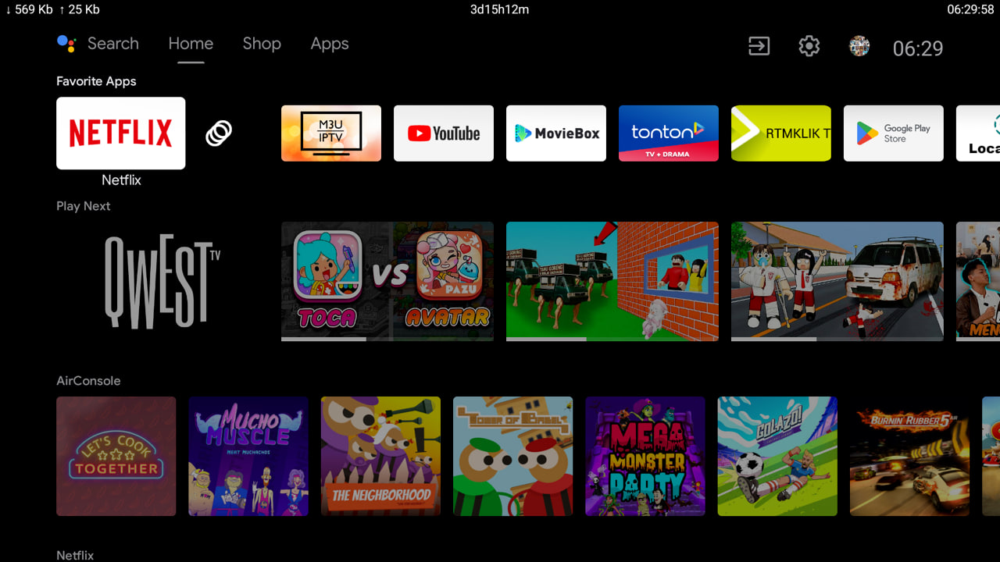
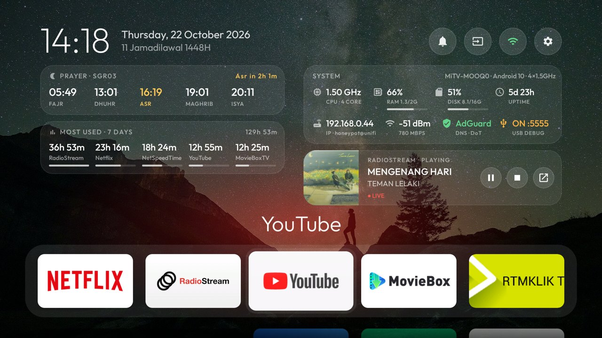
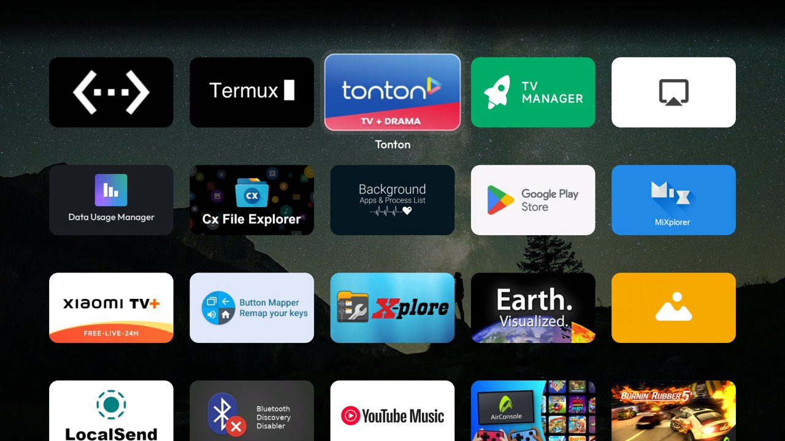
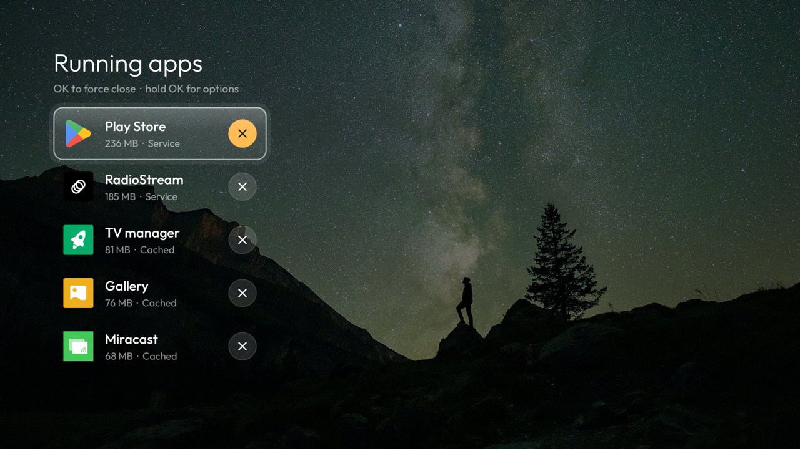
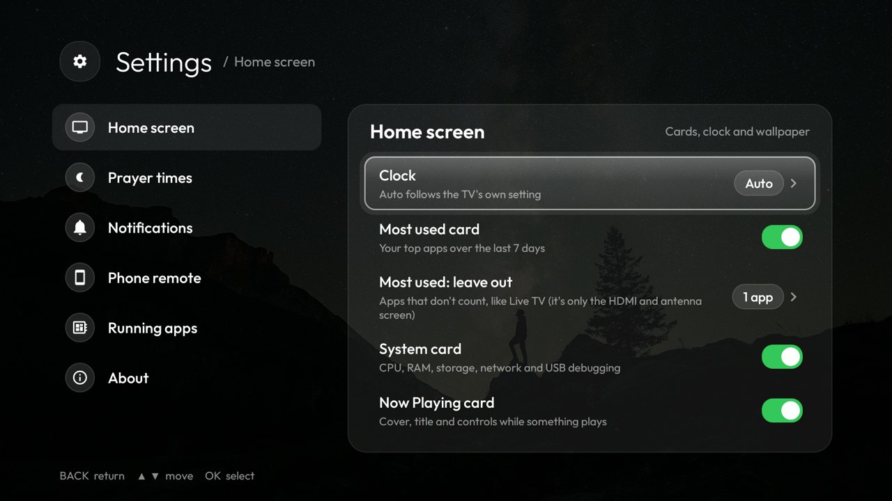
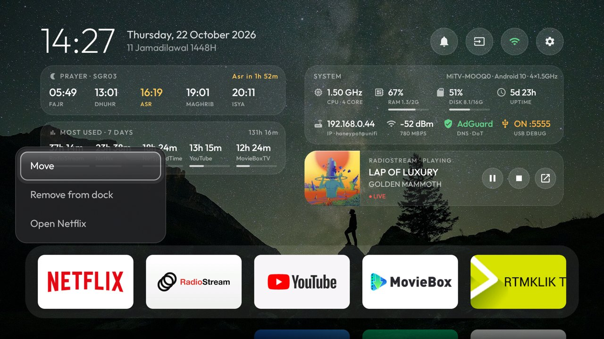
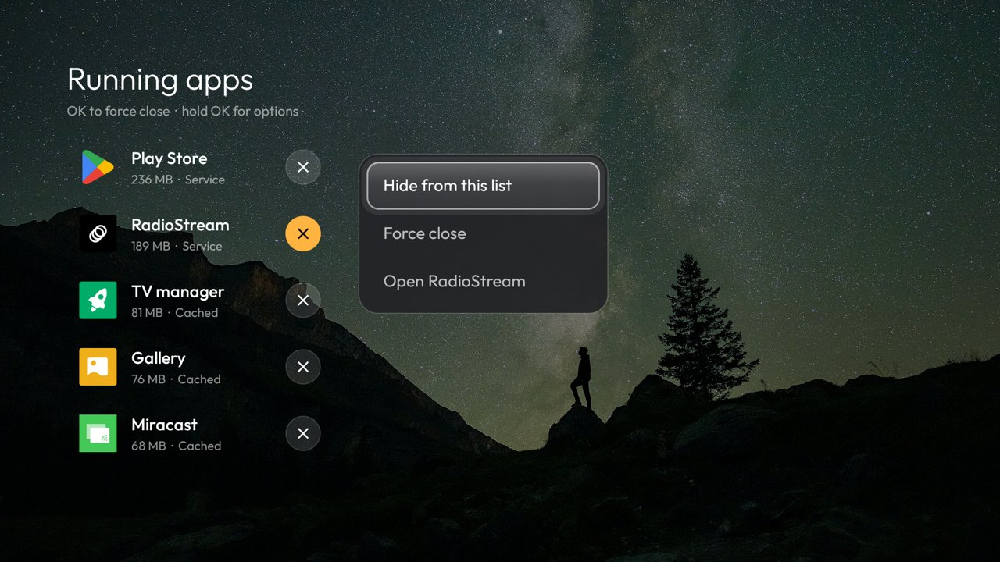
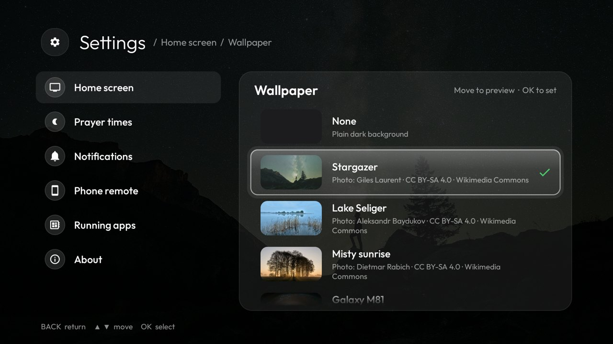

# Mi TV debloat + Apple TV style launcher

TV: **Xiaomi Mi TV MOOQ0** ("croods", MediaTek, Android TV 10 / SDK 29, 1080p), at `192.168.0.44`.
Done on 2026-10-20. Every step was checked with screenshots pulled from the TV (`shots/`).

**To do the same on your own TV,** paste [PROMPT.md](PROMPT.md) into any AI coding agent that can run shell commands on your computer.

<table>
  <tr>
    <th width="50%">Before: stock Android TV home</th>
    <th width="50%">After: this launcher (v1.2)</th>
  </tr>
  <tr>
    <td width="50%"></td>
    <td width="50%"></td>
  </tr>
  <tr>
    <td valign="top">Rows of recommendations and sponsored content, with your apps squeezed into one line.</td>
    <td valign="top">Your apps, the time and what matters at a glance: prayer times, most used apps, a live system card and Now Playing, over a calm wallpaper.</td>
  </tr>
</table>

## Demo

https://github.com/user-attachments/assets/8c54b279-a93a-4732-a06b-bfd6f9cd3b32

Recorded on the TV (2 minutes, no sound): the dock's name and glow following focus, Now Playing, the running-apps screen and its hold-OK menu, Settings with wallpapers previewed as you move, the prayer zone list, and moving an app in the dock.

## Features

<table>
  <tr>
    <td width="50%"></td>
    <td width="50%"></td>
  </tr>
  <tr>
    <td valign="top"><b>Home</b>: big clock with the date and Hijri date, today's prayer times with a countdown, your most used apps this week, a system card (CPU, RAM, storage, network, USB debugging), Now Playing with cover art and controls, and a five-app dock you arrange yourself.</td>
    <td valign="top"><b>All apps</b> (Down from the dock): five per row, most used first, with a glass focus highlight that springs from tile to tile. Hold OK on any app to add it to the dock.</td>
  </tr>
  <tr>
    <td width="50%"></td>
    <td width="50%"></td>
  </tr>
  <tr>
    <td valign="top"><b>Running apps</b> (Up from the top bar): what's running, how much memory each app uses and what it's doing. OK force-closes; hold OK to hide an app from the list.</td>
    <td valign="top"><b>Settings</b> (the gear): prayer zone (all 60 JAKIM zones), which cards show, 12/24-hour clock, wallpaper, what the bell tells you, the phone remote, and more. Changes apply straight away.</td>
  </tr>
  <tr>
    <td width="50%"></td>
    <td width="50%"></td>
  </tr>
  <tr>
    <td valign="top"><b>Your dock, your order</b>: hold OK on a dock app for <b>Move</b> (◀ ▶, then OK to place), <b>Remove from dock</b> or <b>Open</b>; hold OK on any app in the grid to add it. The phone remote can edit the dock too.</td>
    <td valign="top"><b>Hide apps you never close</b>: hold OK on a running app and choose <b>Hide from this list</b>. Hidden apps wait under a "Hidden apps" row at the bottom, and Settings → Running apps brings them back.</td>
  </tr>
  <tr>
    <td width="50%"></td>
    <td width="50%" valign="top">
      <b>Also:</b>
      <ul>
        <li><b>Wallpapers</b>: seven photos from Wikimedia Commons, previewed as you move through the list, plus your own pictures from a <code>Wallpapers</code> folder.</li>
        <li><b>Notifications bell</b>: Play Store updates, new HDMI devices, Bluetooth devices and low memory.</li>
        <li><b>Connection banner</b> over any app when Wi-Fi drops or loses internet.</li>
        <li><b>Inputs</b> menu for HDMI 1–3, AV and Live TV.</li>
        <li>Light: a 0.6 MB app that uses about half the stock launcher's memory, with less than half its janky frames (<a href="#benchmark-this-launcher-vs-the-stock-launcher-2026-10-22">benchmark</a>).</li>
      </ul>
    </td>
  </tr>
  <tr>
    <td valign="top"><b>Wallpapers</b>: move to preview, OK to set. Add your own from the phone remote's Files tab.</td>
    <td></td>
  </tr>
</table>

<table>
  <tr>
    <td align="center" width="33%"></td>
    <td align="center" width="33%"></td>
    <td align="center" width="33%"></td>
  </tr>
  <tr>
    <td colspan="3" align="center"><b>Phone remote</b> in the phone's browser, no app to install: swipe to move, type into any app, open apps, switch inputs, edit the dock and send files to the TV. See <a href="#phone-remote">Phone remote</a>.</td>
  </tr>
</table>

## Folder structure

```
MiTV-Debloat/
├── README.md
├── PROMPT.md                    paste into an AI coding assistant to repeat this setup on another TV
├── docs/                        README screenshots (before/after, features, phone remote)
├── backup/                      state captured BEFORE any change (local only, not in the repo: it identifies the TV)
│   ├── disabled-by-us.txt       every package this project disabled (restore.sh reads it)
│   ├── packages-*.txt           full package lists (all, system, third-party, disabled)
│   ├── getprop.txt, settings-{global,secure,system}.txt
│   ├── home-default.txt, home-candidates.txt, accessibility.txt, private-dns-before.txt
│   └── dumpsys/                 activities/services of every manufacturer package that was checked
├── launcher/                    the launcher source (Java, AndroidX RecyclerView, minSdk 29, targetSdk 36), incl. the phone remote
├── scripts/
│   ├── build-and-install.sh     build the launcher (R8 release, ~0.6 MB APK), install it, make it the home screen
│   ├── benchmark.sh             measure a launcher's memory, CPU, start-up and smoothness
│   ├── restore.sh               undo everything
│   ├── disable.sh               disable packages (and log them so restore.sh can undo)
│   ├── key.sh / shot.sh         send remote keys / pull a screenshot (for testing)
│   └── env.sh                   TV address (override with TV=ip:5555)
└── shots/                       screenshots taken during the work
```

The scripts need ADB debugging switched on (see [Reconnecting](#reconnecting-adb)).

## What was disabled

Everything was disabled with `pm disable-user --user 0`. Nothing was uninstalled.

| Why | Packages |
|---|---|
| Telemetry | `com.miui.tv.analytics`, `com.xiaomi.statistic`, `com.google.android.feedback`, `com.google.android.tv.bugreportsender` |
| Content / ads / recommendation rows | `com.mitv.tvhome.michannel` (Mi Channel rows), `com.xm.webcontent`, `android.autoinstalls.config.xiaomi.amelie` (pushes app installs), `fusion.android.tv.demo` (store demo), `com.google.android.tvrecommendations`, `com.google.android.leanbacklauncher.recommendations` |
| Background services | `com.android.printspooler`, `com.google.android.leanbacklauncher` (old, unused launcher), `com.mitv.dream` and `com.google.android.backdrop` (unused screensavers) |
| You don't use | `com.amazon.amazonvideo.livingroom` (Prime Video), `com.google.android.videos` (Play Movies), `com.google.android.play.games`, `com.google.android.marvin.talkback`, `com.google.android.katniss` + `com.google.android.tv.assistant` (Google Assistant), `com.xiaomi.mitv.mediaexplorer` |
| Replaced | `com.google.android.tvlauncher` (stock home screen) |

**Re-enabled later:** `com.xiaomi.mitv.tvmanager` (**TV Manager**: Optimize, Memory boost, Cleaner, Deep clean, Uninstall apps). It's in the app grid. It starts at boot and uses Firebase, which is why it was first disabled.

**Kept on purpose:**
- **PatchWall** (`com.mitv.tvhome.atv`): it hosts the Input/Source popup.
- `com.mitv.videoplayer`: it holds PatchWall's data store.
- **Live TV and inputs:** `com.mediatek.wwtv.tvcenter`, `com.mediatek.tvinput`, `com.mediatek.tv.service`, `mitv.service`.
- **Remote and Bluetooth pairing:** `com.mediatek.hotkey.dispatcher` and `com.xiaomi.android.tvsetup.partnercustomizer`.
- **Keyboard, Play Store and Play Services:** Gboard, Play Store, Play Services.
- **Apps and features you ticked:** YouTube, YouTube Music, Netflix, Mi TV+, Mi Music, Chromecast, screen mirroring (MiPlay/Miracast), Xiaomi system updates, Gallery and Clock.
- **Your own installs:** every app you installed yourself was left alone.

**Side effects:**
- The remote's **Assistant/mic button** does nothing now, because Assistant is disabled.
- If your remote has a **Prime Video button**, it won't open anything.

## Re-enabling an app

**One app**, from the computer:
```bash
adb connect 192.168.0.44:5555
adb shell pm enable --user 0 com.google.android.katniss     # e.g. bring Google Assistant back
```
**One app, on the TV:** Settings → Apps → See all apps → Show system apps → pick it → Enable.

**Everything** (all disabled packages, stock launcher, DNS back to automatic):
```bash
scripts/restore.sh                    # keeps the new launcher installed but not used
scripts/restore.sh --remove-launcher  # also uninstalls it
```
Then press Home.

## Speed tweaks

- **Background-restricted apps:** tonton, iQIYI, Viu, iflix and M3U IPTV can't run services or boot tasks while you're not using them. They work normally when you open them, but the first launch is a cold start. The list is in `backup/bg-restricted.txt`, and `restore.sh` lifts the restriction.
  ```bash
  adb shell cmd appops set my.com.tonton.screen RUN_ANY_IN_BACKGROUND ignore   # restrict one more app
  adb shell cmd appops set my.com.tonton.screen RUN_ANY_IN_BACKGROUND allow    # undo for one app
  ```
- **Wi-Fi background scanning is off** (`wifi_scan_always_enabled 0`). Wi-Fi works normally. To undo: Settings → Network & Internet → Scanning always available.
- **Other suggestions, not applied:**
  - **Animations 0.5×:** Developer options → Window/Transition/Animator scale. Makes menus and app launches feel snappier.
  - **Weekly reboot:** after a few days the TV collects lost RAM and swap.
  - **Turn off Play Store auto-update.**
  - **Disable Android TV Remote Service** (`com.google.android.tv.remote.service`) if you never control the TV from your phone.
  - **Time NetSpeed** (`visnkmr.apps.timenetspeed`) has since been uninstalled.
  - **Task killer** "Background Apps & Process List" (`io.github.visnkmr.bapl`) only runs a moment at boot and when opened. It's optional to remove. Using it to kill apps tends to make the TV slower, because killed apps restart from scratch; TV Manager's Memory boost has the same effect.

## Ad-blocking DNS

Private DNS is set to AdGuard (`dns.adguard-dns.com`). It blocks ad and tracker domains in most apps. YouTube still plays and played fine after the change, but **YouTube ads are not blocked**: they come from the same servers as the videos.

To undo it on the TV, go to Settings → Network & Internet → Private DNS → Automatic. From the computer:
```bash
adb shell settings put global private_dns_mode opportunistic
```

## The launcher

- **Dock:** Netflix · YouTube · TV Manager · Gallery · Play Store by default (change it from the TV or phone, see "Change the dock"). The focused app's name appears large above the dock, with a glow in a colour taken from its banner.
- **Top bar** (round icon buttons):
  - **Bell** shows notifications (see below).
  - **Inputs** opens a dropdown with HDMI 1–3, AV and Live TV. It switches through the TV input framework.
  - **Wi-Fi** shows the connection state by colour and opens Wi-Fi settings.
  - **Settings** (gear) opens the launcher's own Settings (see below); its last row, **About → TV settings**, opens the TV's Settings.
- **Remote:**
  - Down from the dock slides up to all other apps (5 per row). Up/Down always move exactly one row.
  - Up from the dock goes to the top bar. Up from the top bar slides down the running-apps screen (see below).
  - Ends of the top bar and rows don't wrap.
  - Back returns to the dock.
  - Home while already home jumps back to the dock.
- **Focus memory:** the last focused tile is remembered, even if the TV kills the launcher.
- **Resource use:** about 45–75 MB of memory (see the benchmark). There is no blur, video or network polling; the clock updates from the system's minute tick.
- **New apps:** they appear automatically; the grid lists your most used apps first, then the rest A–Z.

### Date, Hijri date and prayer times

The top left shows the big clock with the date and Hijri date stacked beside it, level with the pills. Below it, the prayer card's top lines up with the system card's. It shows today's Fajr, Dhuhr, Asr, Maghrib and Isya from JAKIM e-solat. The next prayer is in gold, with a countdown in the card's header. After Isya it shows tomorrow's Fajr.

- **Fetching:** the whole month is fetched once from `esolatApi/takwimsolat&period=month&zone=SGR03` and cached on the TV. It's fetched again only when the month changes. If there's no network, it retries when the network comes back, at most once a minute. The display updates on the clock's minute tick.
- **Zone:** pick it in **Settings → Prayer times → Zone** (all 60 JAKIM zones, from e-solat.gov.my). The card switches straight away and fetches that zone's month. `prayer_zone` in strings.xml is only the default.
- **Permission quirk:** adding a permission like INTERNET to an already-installed app doesn't reach the network firewall on Android 10, so the app gets `EPERM` on sockets. If you ever add one, reinstall cleanly: `adb shell pm uninstall my.rafhan.app.tvhome && scripts/build-and-install.sh`.

### Notifications (bell)

The top bar is four round icon buttons: **bell**, **Inputs**, **Wi-Fi**, **Settings**.
- **Wi-Fi:** the button shows the connection state by its colour (green / amber / red). The network name is on the System card's IP line.
- **Bell:** gets an amber count badge when something new arrives, an idea taken from [Matinee](https://github.com/Jarvis322/matinee). **OK** shows the newest 5. OK on one opens it and clears it, and **Clear all** empties the list.

| Source | How it's detected | OK opens |
|---|---|---|
| Play Store updates | The Play Store's own "updates available" notifications (channels `updates-available` / `UPDATES`), read from `dumpsys notification` at start and every 6 h. Matinee uses a notification listener, which this TV refuses, so the launcher needs `DUMP` + `PACKAGE_USAGE_STATS`, granted by `build-and-install.sh`. | Play Store |
| New HDMI device | HDMI-CEC devices (child inputs under an HDMI port) that appear after start-up. Needs a CEC-capable device. | That HDMI input |
| Bluetooth | A device connecting, or staying disconnected for 2 min. The TV remote and quick reconnects are ignored. | Bluetooth settings |
| Low memory | RAM use above 85 %, checked every minute while the screen is on. Re-arms below 80 %. | TV Manager |

Device and memory alerts also slide in a short banner over any app. The list is kept in memory, so it starts empty after the launcher restarts.

### Connection indicator

- **The Wi-Fi button shows the state** (icon only; the name is on the System card):

  | State | Icon | Text |
  |---|---|---|
  | Connected | green Wi-Fi | network name |
  | Connected, no internet | amber Wi-Fi with a warning | **No internet** |
  | Disconnected | red crossed-out Wi-Fi | **Disconnected** |

- **Banner:** whenever the state changes, a small banner slides in at the top of the screen for a few seconds, **over any app**. It reads "Wi-Fi connected · name", "name · no internet" or "Wi-Fi disconnected". It's shown by the always-running phone-remote service and uses the overlay permission.
- **"No internet"** uses Android's own internet check. It also appears behind a captive portal, and when Private DNS can't be reached.
- **Settling:** changes are settled for 3 s, and a fresh connection gets 10 s to pass the internet check, so a normal reconnect doesn't flash "no internet".

### Now Playing

Under the System card, whenever an app has a media session (RadioStream, Spotify, music apps):
- **Shows:** cover art, title, artist, the app and its state (Playing / Paused).
- **Progress:** a progress bar with time when the track has a length; **LIVE** for streams.
- **Buttons:** **Play/Pause**, **Stop** and **Open app**. Press **Up** from the dock to reach them, Left/Right to move between them, Up again for the top bar.
- **How it reads the session:** this low-RAM TV refuses the permission apps normally use to read other apps' media sessions (notification-listener access). So:
  - **Detecting playback:** every 4 s the card asks Android whether any audio is playing, which is nearly free. Only if something is playing does it read `dumpsys media_session` (the `DUMP` permission, granted by `build-and-install.sh`). That gives the app, title, artist, state and elapsed time.
  - **USB debugging on:** once a session is found, a small helper (`MediaHelper`) starts as the shell user over the launcher's loopback ADB connection and reports the session every 2 s, with cover art, track length and position. It costs about 23 MB and stops when playback ends.
  - **USB debugging off:** no cover art or progress bar, so the app icon stands in.
  - **When it runs:** all of this only while the home screen is up and in focus. It stops under the screensaver.
- **Apps that pause when hidden** (YouTube, Netflix) don't show up while you're on the home screen, because their session ends.

### Running apps (Up from the top bar)

Press **Up** on the top bar and the home screen slides away. A screen with three borderless columns comes down from above. Column 1 lists the running apps; columns 2 and 3 are empty for now.

- **What's listed:** apps you can launch that have a process right now (from `dumpsys activity lru`, which uses the `DUMP` permission). Each row shows the icon, name, memory and state: **On screen**, **Service** (playing or running a foreground service), **Recent** or **Cached**. The most active apps come first, then the biggest.
- **Left out:** the launcher itself, and apps with an enabled accessibility service (Button Mapper). Closing Button Mapper would stop the remote's remapped buttons.
- **Remote:** Up/Down move between rows. **OK** force-closes the focused app (the round ✕ button turns amber on the focused row). Down past the last row, or **Back**, returns to the top bar.
- **Hold OK** (or Menu) on an app: **Hide from this list**, **Force close** or **Open**. Hidden apps aren't offered for force close. They're kept under a **Hidden apps (n)** row at the bottom of the list (only while one of them is running): OK on it shows them, and OK on a hidden app gives **Show in list again**. The hidden list is saved on the TV and survives restarts and reinstalls (not a clean uninstall).
- **USB debugging on:** force close runs `am force-stop` over the launcher's loopback ADB connection, so it closes anything, including apps that are playing. Memory (resident size, from `/proc/<pid>/status`) is read the same way.
- **USB debugging off:** the launcher can only use Android's background kill (`KILL_BACKGROUND_PROCESSES`). It can't stop apps that are on screen or running a service, and the screen says so. Memory isn't shown.
- **Refresh:** the list is read when the screen opens and after each close. Nothing runs while the screen is closed.

### Settings (gear)

The gear at the end of the top bar opens the launcher's Settings: categories on the left, their options on the right (laid out like [Matinee](https://github.com/Jarvis322/matinee)'s). Left/Right switch sides, OK changes the focused option (switches flip, choices cycle, ›-rows open a list), Back steps out (list → options → categories → home). Changes apply straight away and are kept in the launcher's `settings` prefs. Everything starts as the launcher behaved before Settings existed.

| Category | Options |
|---|---|
| Home screen | Clock Auto / 12-hour / 24-hour, Most used card, Most used: leave out (app picker), System card, Now Playing card, wallpaper dim (Off/Low/Medium/High), wallpaper (six built-in photos, your picture or none). A hidden card's column closes up. |
| Prayer times | Zone (picker), prayer card on/off |
| Notifications | Play Store updates, new HDMI devices, Bluetooth, low memory (each on/off), low-memory level 80/85/90 %, connection banner |
| Phone remote | Remote on/off (the banner and bell keep working when it's off), its address, forget all paired phones (press OK twice) |
| Running apps | Apps hidden from the running-apps screen; OK shows one again |
| About | Version, install time, APK size, TV settings |

### Most used apps (last 7 days)

- **The card:** under the prayer card, it shows your top 5 apps over a rolling 7 days, each with its time and a bar, plus the total.
- **The grid:** sorted the same way, most used first. Apps you haven't used stay A–Z after them. Both refresh every time you come back to the home screen.
- **How time is counted, per day:**
  - **Visible time.** This counts watching HDMI or tuner through Live TV, which Android barely counts as "foreground".
  - **Background playback (e.g. RadioStream audio)**, but only on days the app was also on screen. On this TV a group of always-on services, such as the NetSpeedTime overlay, MiLink and Live TV's service, log identical whole-day service times that aren't real use.
- **Excluded apps:** Live TV (`com.mediatek.wwtv.tvcenter`) is left out of the ranking. It's only the screen for HDMI, AV and the antenna, so its time is input-watching time, not app use. It isn't on the card or in the total, and it stays in A–Z order in the grid. To leave out more apps, tick them in **Settings → Home screen → Most used: leave out** (`usage_excluded` in apps.xml is only the default).
- **Usage access:** granted by `scripts/build-and-install.sh` with `adb shell appops set my.rafhan.app.tvhome GET_USAGE_STATS allow`. Without it the card shows that command and the grid stays A–Z.
- **History:** Android keeps daily usage detail for about a week, which is exactly what the card needs.

### System panel

The card sits under the pills, starting at the Inputs pill. It shows:

| Row | Cells |
|---|---|
| 1 | CPU clock (average of the cores), RAM used/installed (2 GB; the ~250 MB the firmware reserves for video counts as used), storage used/total for the whole 16 GB chip as in Settings (system partitions count as used), uptime |
| 2 | IP address, Wi-Fi signal (dBm and link speed), Private DNS, USB debugging |

- **Bars:** RAM and storage turn amber over 80% and red over 92%.
- **USB debugging:** shows amber **ON :5555** while network ADB is open, and green **OFF** once you switch it off. It updates the moment the setting changes.
- **CPU:** this firmware blocks apps from reading true CPU load, and the TV has no temperature sensor service. `/proc/stat`, `/proc/loadavg` and the thermal zone are all denied by SELinux, and the thermal HAL is absent. So the card shows the cores' current clock instead. The `ondemand` governor raises it under load. For real CPU % use `adb shell dumpsys cpuinfo`.
- **Refresh:** CPU, RAM and uptime refresh every 2 s, only while the home screen is on screen; the card stops sampling when the app grid or another app is open. Storage refreshes every 30 s. Network and USB values only change on events.
- **Code:** the card lives in `launcher/app/src/main/java/my/rafhan/app/tvhome/SystemPanel.java`.

### Phone remote

Open **http://192.168.0.44:8486** on your phone, on the same Wi-Fi. Use **Add to Home Screen** to get an app icon.

<table>
  <tr>
    <td align="center" width="33%"></td>
    <td align="center" width="33%"></td>
    <td align="center" width="33%"></td>
  </tr>
  <tr>
    <td align="center"><b>Remote</b>: swipe to move, double-tap for OK, plus Back, Home, media, volume and typing</td>
    <td align="center"><b>Apps</b>: the dock, then every app with the most used first. Tap to open on the TV</td>
    <td align="center"><b>Files</b>: browse the TV's storage, upload from the phone, open files on the TV</td>
  </tr>
</table>

**Pairing (once per phone):**
1. Tap **Show PIN on TV**. A 4-digit PIN appears in the middle of the TV for 60 seconds.
2. Type it on the phone. The phone keeps a token.
3. After 5 wrong tries the PIN is voided and you ask for a new one.

**Unpairing:** "Unpair this phone" at the bottom of the page.

| Tab | Does | Works |
|---|---|---|
| Remote | Swipe = D-pad, double-tap = OK | Home screen always. **In any app while USB debugging is on**; otherwise the pad dims in apps |
| Remote | Keyboard, Delete, Enter (only shown while USB debugging is on) | Type into any text field on the TV, e.g. YouTube or Netflix search (letters, numbers, symbols) |
| Remote | Back, Home | Everywhere, through the launcher's accessibility service |
| Remote | Play/Pause | Whatever is playing (Netflix, YouTube, RadioStream…) |
| Remote | Vol −, Mute, Vol + | Everywhere; shows the TV's volume bar |
| Apps | Dock, then all apps most-used first; tap to open | Everywhere |
| Inputs | HDMI 1–3, AV, Live TV | Everywhere |
| Files | Browse internal storage and USB drives. Upload from the phone (with progress), download to the phone, open a video, photo or song on the TV | Everywhere |

**How it works:**
- **No ADB, so USB debugging can be switched off.**
- **Server:** the launcher runs a small foreground service (`RemoteService`) with an HTTP server on port 8486 (`RemoteServer`). It serves `assets/remote.html`.
- **What drives each action:**
  - D-pad keys go to the launcher's own focus logic.
  - Back and Home use `RemoteAccessibilityService`, which only performs those two actions and doesn't read the screen.
  - Media keys and volume go through `AudioManager`.
  - Apps and inputs are normal intents.
- **What it can't do:** without ADB it can't press D-pad keys or type inside other apps. Use the physical remote there.

**D-pad and typing in any app (USB debugging on):**
- **How it works:** Android doesn't let an app press keys in other apps, and on this TV the ADB shell can't write to the remote's `/dev/input` devices either (SELinux). It can create a virtual USB keyboard through `/dev/uhid` with Android's own `hid` command, so the launcher (`AdbKeys`):
  1. Opens an ADB connection to itself (`127.0.0.1:5555`, via the dadb library).
  2. Registers a virtual **keypad** with arrows, Enter, Esc and Delete.
  3. Sends key reports to it, about 50 ms per press.
- **Typing:** uses a second virtual **keyboard**, which is removed after a minute idle. While it exists, Android treats the TV as having a physical keyboard and hides the on-screen keyboard. The keypad has no letter keys, so it doesn't do this.
- **First use:** the TV asks **"Allow USB debugging?"** for the launcher's own key. Tick *Always allow* and accept. The fingerprint is the launcher's key in its private storage.
- **It connects** when a paired phone opens the remote, and drops when USB debugging is turned off. Then the remote falls back to home-screen-only, and the page says so.
- **After a reboot** network ADB (port 5555) may be off again. Turn it back on to get in-app D-pad.
- **Cost:** each virtual device is a small `hid` process, about 20 MB. The keypad is created on the first phone-remote key press inside an app and removed after 5 minutes without one; the keyboard only exists while typing (1 minute idle).
- **Security:** while debugging is on the launcher has ADB shell access, the same power network ADB already gives anyone on your Wi-Fi. Only paired phones can use it.

**Files tab:**
- **Uploads** stream straight to disk, so the size limit is the TV's free space. A 50 MB file takes about 4 s on Wi-Fi.
- **Duplicate names** get " (1)".
- **USB drives:** uploads may be refused, because Android 10 limits apps writing to removable drives. Browsing and downloading still work.
- **Open on TV** uses your "Always" choice if you've set one. Otherwise it picks MX Player for video and audio and X-plore for photos, so Android's "Open with" chooser never appears.
- **Access is limited** to internal storage and USB drives. Paths outside them (`/data`, `../`) are refused.

**Set up by `scripts/build-and-install.sh`:**
- Overlay permission (`appops … SYSTEM_ALERT_WINDOW allow`). It shows the PIN, and Android 10 needs it before the remote can open apps while another app is on screen.
- Storage permissions for the Files tab (`READ`/`WRITE_EXTERNAL_STORAGE`). These are granted right after install.
- The accessibility service, appended next to Button Mapper's. If the Back button says it needs the accessibility service, re-run the script or enable "Home phone remote" in Settings → Device Preferences → Accessibility.

**Security:**
- It's plain HTTP on your LAN. Only paired phones can control it.
- Requests addressed by hostname instead of IP are refused, which blocks DNS-rebinding tricks from web pages.
- If the TV's IP changes, the bookmark breaks. Reserve 192.168.0.44 for the TV in the router.

**Undo:** `scripts/restore.sh` removes the accessibility service and keeps Button Mapper's.

### Change the dock

The dock holds **up to 5 apps**, in any order.

**On the TV**, hold **OK** (or press **Menu**) on an app:
- **On a dock app:**
  - **Move:** the app wiggles. Use ◀ ▶ to slide it, then **OK** (or Back) to place it.
  - **Remove from dock.**
  - **Open.**
- **On an app in the app list:**
  - **Add to dock**, or **Replace a dock app…** when the dock is full. That jumps to the dock, which asks "Replace which app with …?"; pick one with OK, or press Back to cancel.
  - **Open.**

**From the phone remote**, on the Apps tab tap **Edit** next to DOCK:
- ◀ ▶ reorders an app and ✕ removes it.
- **+** on any app below adds it.
- **Done** saves it to the TV, which updates at once.

**Missing apps:** if a dock app isn't installed, or is disabled, it's skipped and the dock shows the others. It comes back by itself once the app is installed or enabled again. The next time you edit the dock it's dropped, so it doesn't hold a hidden slot.

**Where it's stored:** the order is saved in `/sdcard/Android/data/my.rafhan.app.tvhome/files/dock.txt`, one package per line, left to right. You can still push that file over ADB. Delete it to go back to the built-in default (`res/values/dock.xml`).

### Change the wallpaper

**Settings → Home screen → Wallpaper** offers seven photos (lakes, landscapes, forest, night sky and a galaxy), **Your picture** (if you pushed one) and **None**. The photos aren't in the APK. The TV downloads each one once (1920 px, 0.5–1 MB) from Wikimedia Commons and keeps it in the launcher's storage:
- the default (Stargazer, the first in the list) on first start;
- the rest when you first open the Wallpaper list, where their thumbnails appear as they land.

Moving the focus through the list previews each one behind Settings; **OK** sets it, and Back without OK keeps the one you had. **Wallpaper dim** sets how dark it is behind the cards.

| Wallpaper | Photo | Credit · licence |
|---|---|---|
| Stargazer (default) | [Looking at the stars during the Perseids](https://commons.wikimedia.org/wiki/File:018_Human_looking_at_the_stars_during_Perseids_with_the_Milky_Way_in_the_background_Photo_by_Giles_Laurent.jpg) | Giles Laurent · CC BY-SA 4.0 |
| Lake Seliger | [Lake Seliger, view of Voroniy Island](https://commons.wikimedia.org/wiki/File:Lake_Seliger._Ostashkov._View_of_Voroniy_Island.jpg) | Aleksandr Baydukov · CC BY-SA 4.0 |
| Misty sunrise | [Dülmen, Umland, 2014](https://commons.wikimedia.org/wiki/File:D%C3%BClmen,_Umland_--_2014_--_7056.jpg) | Dietmar Rabich · CC BY-SA 4.0 |
| Galaxy M81 | [Messier 81 (Hubble)](https://commons.wikimedia.org/wiki/File:Messier_81_HST.jpg) | NASA, ESA and the Hubble Heritage Team · public domain |
| Dome Creek | [Lake in Dome Creek](https://commons.wikimedia.org/wiki/File:Lake_in_Dome_Creek.jpg) | Jakub Fryš · CC BY-SA 4.0 |
| Forest light | [Roruper Holz nature reserve, 2021](https://commons.wikimedia.org/wiki/File:D%C3%BClmen,_Rorup,_NSG_Roruper_Holz_--_2021_--_8187-91.jpg) | Dietmar Rabich · CC BY-SA 4.0 |
| Night clouds | [Noctilucent clouds over Kuresoo bog](https://commons.wikimedia.org/wiki/File:Helkivad_%C3%B6%C3%B6pilved_Kuresoo_kohal.jpg) | Martin Koitmäe · CC BY-SA 4.0 |

**Your own pictures** go in the **Wallpapers** folder on the TV's internal storage (`/sdcard/Wallpapers`). Any JPG, PNG or WebP there shows up at the end of the Wallpaper list under its file name, with a thumbnail; preview and set it like the built-in ones. Ideally 1920×1080 or larger; big photos are scaled down when loaded.
- **Phone remote:** Files tab → **Wallpapers** (the shortcut under the storage list) → Upload.
- **ADB:** `adb push mypicture.jpg /sdcard/Wallpapers/`

Deleting a picture that's in use switches back to the default. The folder survives a launcher uninstall; the downloaded built-in photos don't. (An older picture pushed to `Android/data/my.rafhan.app.tvhome/files/wallpaper.jpg` still appears as **Your picture**.)

### Hidden system apps

Some system apps only have a phone-style launcher entry. On this TV those are setup leftovers (a Netflix helper and a "Disclaimer Customization" screen), so the grid hides them. Clock is the exception. To show another one, add its package to `launcher/app/src/main/res/values/apps.xml` and rebuild.

### Rebuild / reinstall

```bash
scripts/build-and-install.sh                 # build, install, set as home
scripts/build-and-install.sh --disable-stock # same, and disable the stock launcher again (e.g. after restore)
```
Notes on the install:
- It uses `pm install` over the shell, not `adb install`.
- It grants location permission so the Wi-Fi pill can show the network name. Android 10 requires that.
- It uses `cmd package set-home-activity`, because several apps claim HOME on this TV: the factory test, tvusage and FallbackHome.
- While the stock launcher is enabled, it always wins (its priority is 2). That's why it has to be disabled.

## Benchmark: this launcher vs the stock launcher (2026-10-22)

Measured with `scripts/benchmark.sh <home component> <label>`, using the optimised R8 release build. Conditions:
- Nothing was playing, and USB debugging was on.
- The stock launcher ran without its recommendation services, which this setup disables.

| | This launcher | Stock Android TV launcher |
|---|---|---|
| Memory, idle, settled / after navigating (PSS) | **44 / 75 MB** | 94 / 124 MB |
| CPU, idle, 60 s | 0.19 s | 0.14 s |
| Cold start (process killed → first frame) | 0.60–1.05 s | 0.56–0.81 s |
| Back to home from an app (wait time) | 233–308 ms | 214–284 ms |
| Janky frames while navigating | **7.6 % (43/566)** | 18.9 % (62/328) |
| Frame time p50 / p90 / p99 | 8 / **10** / 65 ms | 6 / 27 / 69 ms |
| APK size | 0.5 MB | 12.7 MB |

**Notes:**
- **Extra processes only while used:** the launcher is a single process at idle. The Now Playing helper (~23 MB) runs only while something plays, and the virtual keypad (~21 MB) only for 5 minutes after a phone-remote key press inside an app.
- **Screensaver:** under the screensaver the launcher uses no CPU (0 ticks in 60 s). The System card refreshes every 5 s, and only while home is on screen and in focus.
- **Other apps in front:** after 30 s with another full-screen app in front, the app-list tile images are freed and redrawn on return. Hardware bitmaps live in graphics memory, so this saving doesn't show up in PSS.
- **Before these optimisations** the same benchmark measured 104 / 133 MB, 0.54 s idle CPU, 2.0–2.1 s cold start and 11.4 % janky frames.

## Reconnecting ADB

All scripts talk to the TV over network ADB. To use them again:
1. Settings → Device Preferences → About → press OK on **Build** 7 times.
2. Settings → Device Preferences → Developer options → **USB debugging** on.
3. On the computer: `adb connect 192.168.0.44:5555`, then accept the prompt on the TV.

If the TV gets a new IP, run `TV=<new-ip>:5555 scripts/restore.sh` (works for any script).

**When you're done, switch USB debugging off again.** While it's on, anyone on your network can control the TV.
