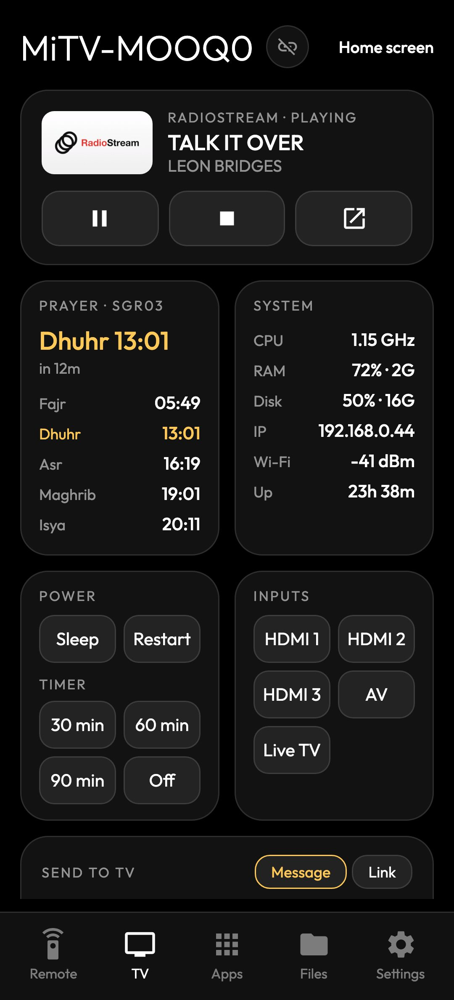
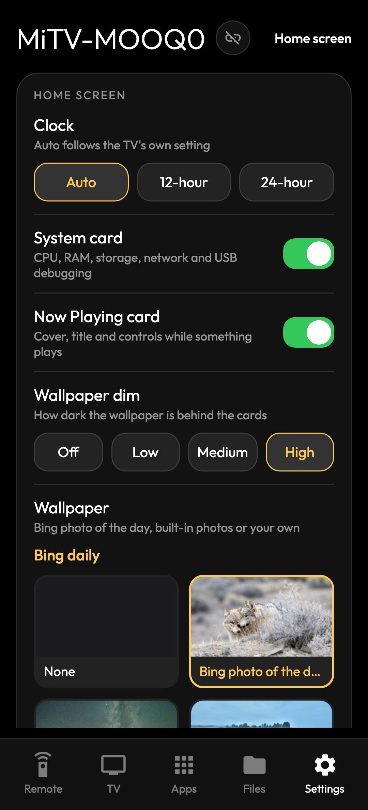

# Mi TV debloat + Apple TV style launcher

A fast, minimal home screen for **Android TV and Google TV** (Android 10 or newer), with prayer times, a live system card, Now Playing, a running-apps screen and a phone remote. It was built on a Xiaomi Mi TV, which was also [debloated](docs/xiaomi-debloat.md).

**Install it on your TV:** [Windows](docs/install-windows.md) · [macOS](docs/install-macos.md) · [Linux](docs/install-linux.md) · [with an AI agent](docs/install-with-ai-agent.md)

<table>
  <tr>
    <th width="50%">Before: stock Android TV home</th>
    <th width="50%">After: this launcher (v1.5)</th>
  </tr>
  <tr>
    <td width="50%"></td>
    <td width="50%"></td>
  </tr>
  <tr>
    <td valign="top">Rows of recommendations and sponsored content, with your apps squeezed into one line.</td>
    <td valign="top">Your apps, the time and what matters at a glance: prayer times, most used apps, a live system card and Now Playing, over a calm wallpaper.</td>
  </tr>
</table>

## Demo

https://github.com/user-attachments/assets/8c54b279-a93a-4732-a06b-bfd6f9cd3b32

Recorded on the TV (2 minutes, no sound): the dock's name and glow following focus, Now Playing, the running-apps screen and its hold-OK menu, Settings with wallpapers previewed as you move, the prayer zone list, and moving an app in the dock.

## Features

<table>
  <tr>
    <td width="50%"></td>
    <td width="50%"></td>
  </tr>
  <tr>
    <td valign="top"><b>Home</b>: big clock with the date and Hijri date, today's prayer times with a countdown, your most used apps this week, a system card (CPU, RAM, storage, network, USB debugging), Now Playing with cover art and controls, and a five-app dock you arrange yourself.</td>
    <td valign="top"><b>All apps</b> (Down from the dock): five per row, most used first, with a glass focus highlight that springs from tile to tile. Hold OK on any app to add it to the dock.</td>
  </tr>
  <tr>
    <td width="50%"></td>
    <td width="50%"></td>
  </tr>
  <tr>
    <td valign="top"><b>Running apps</b> (Up from the top bar): what's running, how much memory each app uses and what it's doing. OK force-closes; hold OK to hide an app from the list.</td>
    <td valign="top"><b>Settings</b> (the gear): prayer zone (all 60 JAKIM zones), azan and prayer reminders, which cards show, 12/24-hour clock, wallpaper, the Most used week, what the bell tells you, the phone remote, and more. Changes apply straight away.</td>
  </tr>
  <tr>
    <td width="50%"></td>
    <td width="50%"></td>
  </tr>
  <tr>
    <td valign="top"><b>Your dock, your order</b>: hold OK on a dock app for <b>Move</b> (◀ ▶, then OK to place), <b>Remove from dock</b> or <b>Open</b>; hold OK on any app in the grid to add it. The phone remote can edit the dock too.</td>
    <td valign="top"><b>Hide apps you never close</b>: hold OK on a running app and choose <b>Hide from this list</b>. Hidden apps wait under a "Hidden apps" row at the bottom, and Settings → Running apps brings them back.</td>
  </tr>
  <tr>
    <td width="50%"></td>
    <td width="50%" valign="top">
      <b>Also:</b>
      <ul>
        <li><b>Azan</b> at each prayer time with a banner over any app, plus a silent reminder a few minutes before (you choose how early).</li>
        <li><b>Wallpapers</b>: Bing's photo of the day (scenery only, no people), seven photos from Wikimedia Commons, previewed as you move through the list, plus your own pictures from a <code>Wallpapers</code> folder.</li>
        <li><b>Notifications bell</b>: Play Store updates, new HDMI devices, Bluetooth devices and low memory.</li>
        <li><b>Connection banner</b> over any app when Wi-Fi drops or loses internet.</li>
        <li><b>Inputs</b> menu for HDMI 1–3, AV and Live TV.</li>
        <li>Light: a 0.7 MB app that uses about half the stock launcher's memory, with less than half its janky frames (<a href="#benchmark">benchmark</a>).</li>
      </ul>
    </td>
  </tr>
  <tr>
    <td valign="top"><b>Wallpapers</b>: move to preview, OK to set. Add your own from the phone remote: Settings → Wallpaper → Your photo.</td>
    <td></td>
  </tr>
</table>

<table>
  <tr>
    <td align="center" width="33%"></td>
    <td align="center" width="33%"></td>
    <td align="center" width="33%"></td>
  </tr>
  <tr>
    <td colspan="3" align="center"><b>Phone remote</b> in the phone's browser, no app to install: swipe to move, type into any app, open and manage apps, see what's playing, prayer times and the bell, send a message or a link to the TV, change Settings and the wallpaper, a sleep timer, and send files to the TV. See <a href="docs/features.md#phone-remote">Phone remote</a>.</td>
  </tr>
</table>

## Install

You need an Android TV or Google TV running Android 10 or newer, and a computer on the same Wi-Fi. The scripts build the launcher, install it over network ADB and make it the home screen; they work with any TV brand.

- Step by step: [Windows](docs/install-windows.md) · [macOS](docs/install-macos.md) · [Linux](docs/install-linux.md)
- Let an AI coding agent do it: [Install with an AI agent](docs/install-with-ai-agent.md)
- Debloat the TV too, from scratch: give an AI agent [PROMPT.md](PROMPT.md)

## Using it

| On the remote | Does |
|---|---|
| Left / Right on the dock | Move between your five dock apps |
| Down from the dock | All apps, most used first |
| Up from the dock | Now Playing controls (when something plays), then the top bar |
| Up from the top bar | Running apps: OK force-closes, hold OK for options |
| Hold OK on an app | Move, add or remove dock apps, or open |
| The gear | Settings: wallpaper, prayer zone, azan, cards, notifications, phone remote |
| Back / Home | Back to the dock |

**Phone remote:** open `http://<TV IP>:8486` in your phone's browser on the same Wi-Fi and pair with the PIN shown on the TV. Settings → Phone remote shows the exact address. Five tabs:

| Tab | What's on it |
|---|---|
| Remote | Swipe for the D-pad, double-tap for OK, Back, Home, Play/Pause, volume; with USB debugging on, a keyboard for any app and a screenshot of the TV |
| TV | Now Playing, prayer times, system info, the bell's notifications, inputs, power and a sleep timer, and **Send to TV**: a message (a box on the TV until OK) or a link (YouTube and Netflix open in their apps) |
| Apps | Running apps (close or hide), the dock, all apps; hold an app for dock, force close or disable |
| Files | The TV's storage and USB drives: upload, download, open on the TV |
| Settings | The TV's Settings from the phone, including the wallpaper (or upload a photo and set it) and a searchable prayer zone list |

More: [how every feature works](docs/features.md).

## Benchmark

Against the stock Android TV launcher on the Mi TV (2026-10-22). Method and notes: [development.md](docs/development.md#benchmark).

| | This launcher | Stock Android TV launcher |
|---|---|---|
| Memory, idle, settled / after navigating (PSS) | **44 / 75 MB** | 94 / 124 MB |
| CPU, idle, 60 s | 0.19 s | 0.14 s |
| Cold start (process killed → first frame) | 0.60–1.05 s | 0.56–0.81 s |
| Back to home from an app (wait time) | 233–308 ms | 214–284 ms |
| Janky frames while navigating | **7.6 % (43/566)** | 18.9 % (62/328) |
| Frame time p50 / p90 / p99 | 8 / **10** / 65 ms | 6 / 27 / 69 ms |
| APK size | 0.5 MB | 12.7 MB |

## Undo

```bash
scripts/restore.sh                    # back to the TV's own launcher; re-enables anything this project disabled
scripts/restore.sh --remove-launcher  # ...and uninstalls this launcher
```

**When you're done, turn USB debugging off** (Developer options): while it's on, anyone on your Wi-Fi can control the TV. Without it the phone remote still works, minus the D-pad and keyboard inside apps, screenshots, sleep/restart and the sleep timer, and disabling apps.

## More

- [How every feature works](docs/features.md): prayer times and azan, bell, Now Playing, running apps, Settings, Most used, System card, phone remote, dock, wallpapers (with photo credits)
- [Debloating the original Mi TV](docs/xiaomi-debloat.md): what was disabled and kept, speed tweaks, ad-blocking DNS
- [Development](docs/development.md): folder structure, rebuilding, benchmark method
- [PROMPT.md](PROMPT.md): the prompt to repeat the whole setup on another TV with an AI agent
